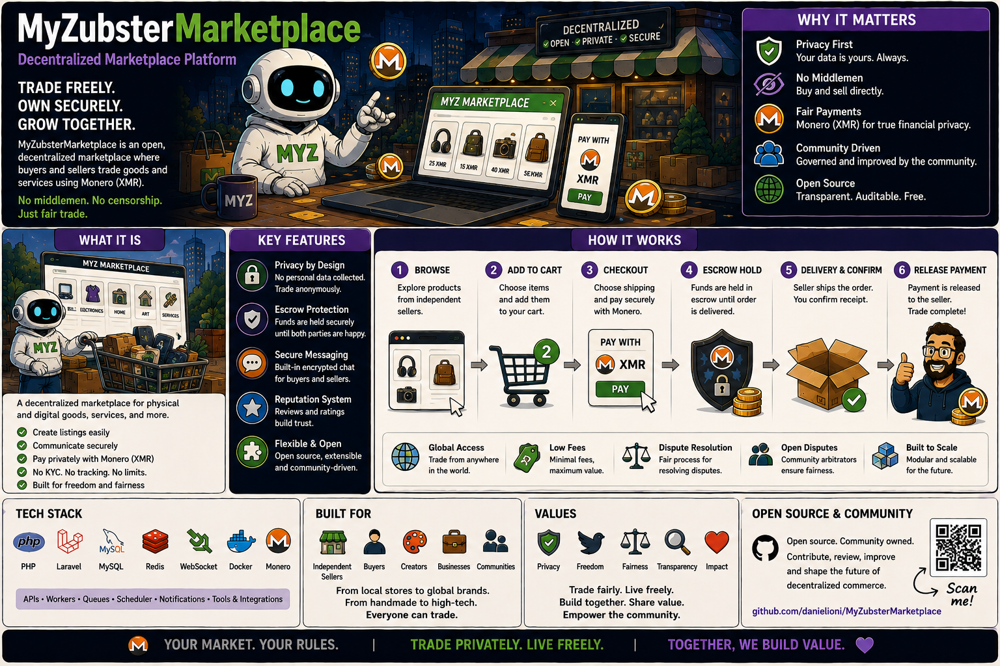

# MyZubster Marketplace

<p align="center">
  
</p>

> 🌍 **Understand MyZubster in your language:** [Global multilingual guide](https://github.com/MyZubster-Ecosystem/myzubster/blob/main/docs/i18n/README.md) — English, Italiano, Español, Français, Deutsch, Português, 中文, 日本語, 한국어, العربية, हिन्दी, Русский, Türkçe, Bahasa Indonesia, Polski, Українська, বাংলা, اردو, فارسی, Kiswahili.
>
> MyZubster connects real-world observations, verifiable evidence, collaborative bounties and platform rewards. **MYZ is currently an internal reward/accounting ledger; external XMR/token/blockchain settlement is separate and independently verified.**

Marketplace/service repository in the MyZubster ecosystem, currently containing garden and sensor-oriented API work plus historical bounty-linked development.

## Status

**Development / active validation.** Implemented endpoints and tests should be verified from the current source tree before production use.

Payment, payout, subscription renewal and settlement endpoints are fail-closed. They require an authenticated user and a ready MongoDB connection. Until an independent settlement provider is configured, the API may create only unverified payment intents and must not emit synthetic transaction IDs or report external settlement as completed.

Payment batches and subscriptions are stored in MongoDB and scoped to the authenticated user. Fractional monetary amounts must be sent as decimal strings (up to 18 fractional digits); floating-point JSON numbers are rejected on persisted financial records.

Historical bounty labels or amounts in issues/commits are records of project intent/work tracking. They are **not proof that an external XMR/MYZ settlement occurred**.

## Seller onboarding

New sellers can start with **Seller Free — €0**. Creating a seller account does **not** require a credit card or payment method.

```text
Register seller
      ↓
Seller Free — €0
      ↓
No credit card required
      ↓
Profile / catalog setup
      ↓
Explicit upgrade
      ↓
Payment method required
      ↓
Paid plan
```

The current seller API exposes `GET /api/seller/plans`, where the free plan reports `creditCardRequired: false`. Seller registration defaults to `sellerPlan: free` and `sellerPaymentMethodStatus: not_required`.

A payment method becomes relevant only when the seller explicitly requests an upgrade. Paid billing is currently **not enabled**: `POST /api/seller/upgrade` fails closed with `SELLER_BILLING_PROVIDER_NOT_CONFIGURED` until a reviewed billing provider is connected. The Marketplace API must not accept or persist raw card numbers, CVV/CVC, or equivalent card credentials.

In product copy, the intended message is:

> **Start selling for free. No credit card required.**  
> Upgrade when you're ready; add a payment method only when you choose a paid plan.

## MYZ conversion gateway

A fail-closed conversion gateway is under development for a future external-provider settlement model. It separates quote, provider fee, MyZubster service fee, settlement evidence and audit events.

Coinbase Advanced Trade is currently implemented only as a **technical candidate probe**. Candidate mode is non-executable and does not imply Coinbase supports MYZ. Live MYZ conversion remains blocked until MYZ has a real, reviewed external asset/settlement path and a provider supports that path.

The branch also includes read-only operator reconciliation tooling, reviewed repair runbooks, and a fail-closed repair preview endpoint that reports `WOULD_BLOCK`, `WOULD_ALLOW_REVIEW`, or `WOULD_ALLOW_NO_ACTION` without mutating MYZ, reservations, provider settlement, or canonical ledger state.

See:

- [`docs/MYZ_CONVERSION_GATEWAY.md`](docs/MYZ_CONVERSION_GATEWAY.md)
- [`docs/MYZ_RECONCILIATION_OPERATOR_REPORT.md`](docs/MYZ_RECONCILIATION_OPERATOR_REPORT.md)
- [`docs/MYZ_RECONCILIATION_REPAIR_RUNBOOKS.md`](docs/MYZ_RECONCILIATION_REPAIR_RUNBOOKS.md)
- [`docs/MYZ_RECONCILIATION_REPAIR_PREVIEW.md`](docs/MYZ_RECONCILIATION_REPAIR_PREVIEW.md)
- [External MYZ settlement blocker #63](https://github.com/MyZubster-Ecosystem/MyZubster-Marketplace/issues/63)

## Current API areas

### Gardens

```text
GET    /api/gardens
GET    /api/gardens/:id
GET    /api/gardens/nearby
POST   /api/gardens
PUT    /api/gardens/:id
DELETE /api/gardens/:id
```

### Sensors

```text
POST /api/sensors/data
GET  /api/sensors/garden/:id
GET  /api/sensors/garden/:id/latest
GET  /api/sensors/garden/:id/stats
```

Treat this list as a repository overview; verify the actual router/controller implementation and tests when integrating.

## Bounty history

Some features originated from bounty-labelled work, including garden map and Arduino pH/EC tasks. A feature being implemented or merged does not establish that the associated reward was externally paid.

Current bounty rules are centralized here:

- [MyZubster Bounty System](https://github.com/MyZubster-Ecosystem/myzubster/blob/main/BOUNTIES.md)
- [Ecosystem Architecture](https://github.com/MyZubster-Ecosystem/myzubster/blob/main/docs/ECOSYSTEM.md)

MYZ in the current core platform is an internal reward/accounting ledger. Any external XMR/token settlement requires independently verifiable payment evidence before it can be represented as `PAID`.

See `BOUNTIES.md` in this repository for Marketplace-specific bounty scope.

## Development

Use the package scripts present in the repository. A normal Node.js workflow is:

```bash
npm ci
npm test
npm audit --audit-level=high
```

Check `.env.example` and the actual package scripts before starting services. Do not commit secrets or production credentials.

## Security

Sensor/garden APIs should validate authentication, authorization, input ranges and ownership boundaries where applicable. External payment/provider integrations must fail closed and must not self-declare settlement finality.

`GET /api/health` is a liveness check. `GET /api/ready` returns HTTP `503` until MongoDB is connected. Deployments should route traffic to authentication and payment endpoints only when readiness is green.

## Related repositories

- [myzubster](https://github.com/MyZubster-Ecosystem/myzubster) — core ecosystem
- [MyZubsterGateway](https://github.com/MyZubster-Ecosystem/MyZubsterGateway) — integration/settlement boundary
- [MyZubster-App](https://github.com/MyZubster-Ecosystem/MyZubster-App) — client application
- [myzubster-docs](https://github.com/MyZubster-Ecosystem/myzubster-docs) — documentation hub
